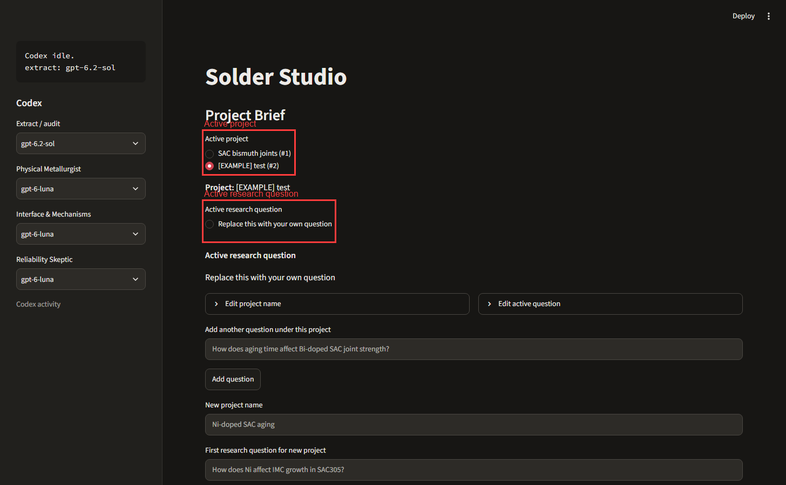
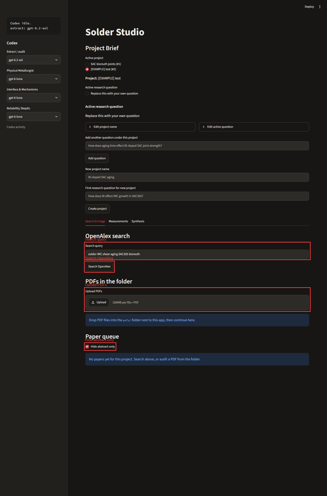
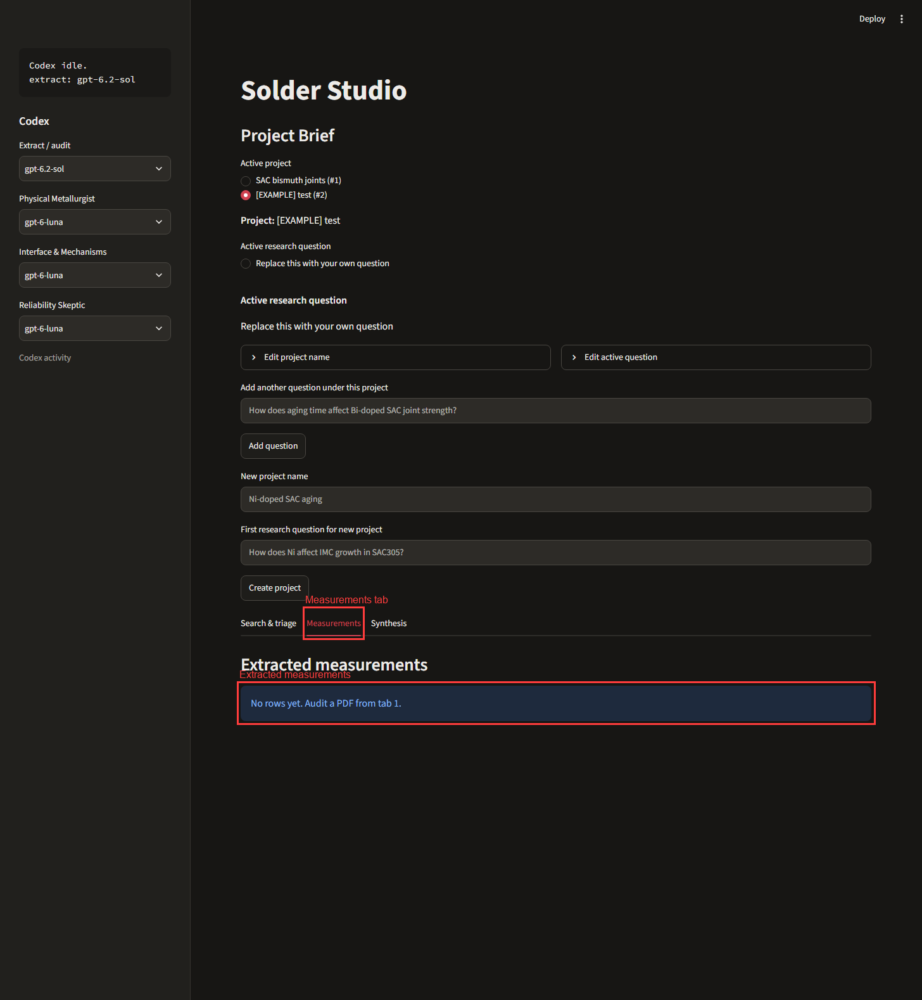
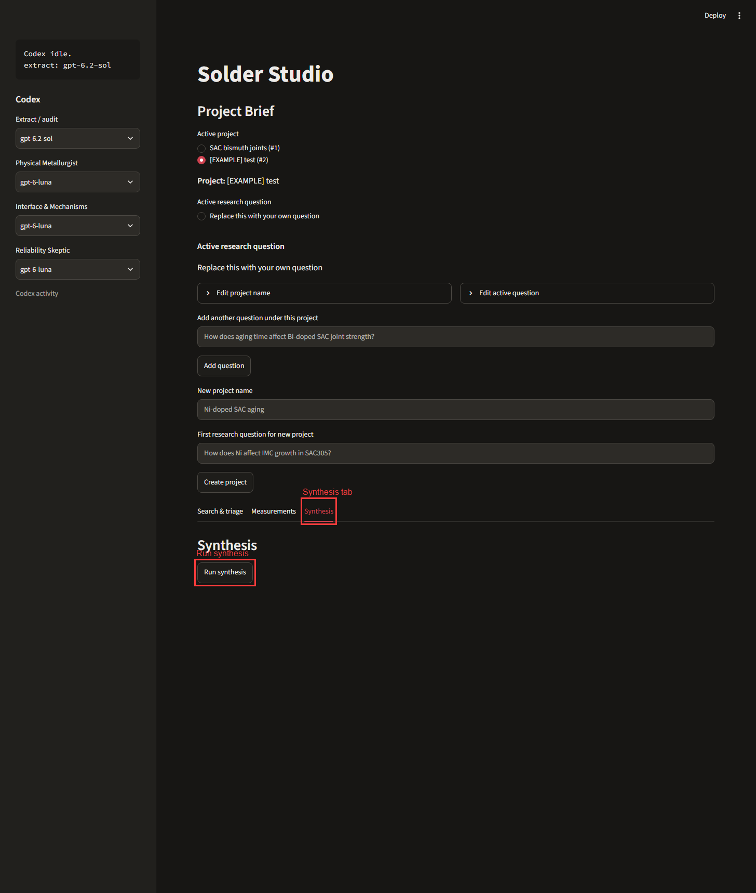
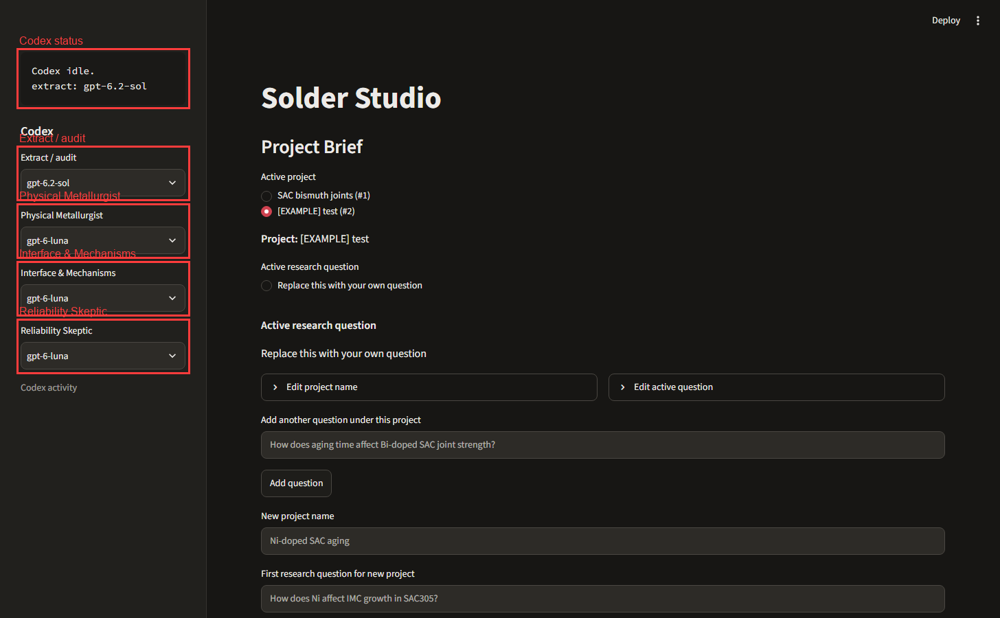

# Solder Studio

Solder Studio is a small research app on your own computer. You use it in a web browser to search metallurgy papers, save PDFs when they are available, triage what matters, pull numbers out of papers, and run a three-lens summary of what the literature says. Everything stays local: your papers, your notes, and your database.

You do not need to be a programmer. Double-click a file to start, then click through the page.

## Start the app

1. Open this folder in File Explorer.
2. Double-click **`Start_Research_Studio.bat`**.
3. The first time may take two or three minutes while **uv** downloads Python packages.
4. If asked, sign in to **ChatGPT** for **Codex** (the AI that reads PDFs). This app does not use an API key and does not read a `.env` file.
5. When the window says Streamlit is running, open **http://localhost:8501** in your browser (the batch file usually opens it for you).

Leave the black command window open while you work. Close it when you are done for the day.

## What a project and a question mean

A **project** is a named workspace. All PDFs and paper records for that name live in one shared list.

A **research question** is the hypothesis you are testing against that list. You can have many questions under one project. Only the **active question** drives audits, extracted numbers, and synthesis—but the same papers stay in the project for every question.

The app ships with a real starter project: **SAC bismuth joints**, with a default question about bismuth in Sn–Ag–Cu solder on copper.

There is also **`[EXAMPLE] test`**. That project is empty on purpose. Use it to try buttons, rename it, or change the example question, which reads **`Replace this with your own question`**, without touching your real work.

### Pick project and question



1. Under **Project Brief**, choose **Active project** (red radio buttons).
2. Choose **Active research question** the same way. The full question text wraps so you can read it.
3. To change the project name, open **Edit project name**, type, then **Save project name**.
4. To change the question, screening criteria, or target metrics, open **Edit active question**, edit, then **Save question**.
5. Use **New project name** and **Create project** when you begin a real study.

## Search & triage (find and rank papers)



This tab is where you build the reading list.

**OpenAlex search**

- The search box is prefilled with an example query. Edit it or run it as-is.
- Click **Search OpenAlex**. Empty search is blocked.
- Results are stored for the active **project**. OpenAlex does not need an API key.
- Many university papers appear with only an **abstract** online. Those stay in the database for triage. A file is saved under `pdfs/` only when the app receives a real **PDF** body from OpenAlex (naming pattern `AuthorName_Title.pdf`).
- Uncheck **Hide abstract-only** to see abstract-only rows again. They show **no local PDF** until you add a file.

**Your own PDFs**

- Use **Upload PDFs**, or copy files into the **`pdfs`** folder next to the app.
- The app **does not rename** files you upload or drop in.
- Use **Create paper & audit** or **Audit all PDFs** for files in the folder.

**Queue and paper detail**

- After search, the **Paper queue** table lists papers (with filters for triage, tags, and sort order when you have papers).
- Pick a row in **Paper detail** under the table to see the audit, open the PDF, run **Audit PDF (extract rows)**, or **Save tags**.
- **Audit selected** runs on rows you check in the table (full-text papers with a local file).

Tags and triage scores apply to the **active question**; tags themselves are shared across the project.

## Measurements (table, plot, CSV)



After you audit PDFs on **Search & triage**, extracted numbers appear here for the **active question**.

- Filter by paper, material, and metric.
- Download **CSV** for spreadsheets.
- Use the plotter: pick **X** and **Y** from metrics that share the same unit so axes stay honest.

If you see “No rows yet,” audit at least one full-text PDF on tab 1.

## Synthesis (three expert lenses)



When you have enough quote-verified rows, click **Run synthesis**. The app runs three readings in order:

1. **Physical Metallurgist** — structure, phases, what the data support.
2. **Interface & Mechanisms Specialist** — intermetallic layers, interfaces, mechanisms.
3. **Reliability Skeptic** — what is safe to claim, what needs a caveat, what is missing.

Read the briefing on the page and download the HTML copy. Synthesis does not pick the reading list—that stays on **Search & triage**.

## Sidebar: models and Codex status



The left sidebar shows whether Codex is idle or busy.

Four dropdowns choose the AI model **for this browser session only** (they are not saved in the database). Defaults:

| Job | Default model |
| --- | --- |
| Paper audit and measurement extraction | `gpt-6.2-sol` |
| Physical Metallurgist | `gpt-6-luna` |
| Interface & Mechanisms Specialist | `gpt-6-luna` |
| Reliability Skeptic | `gpt-6-luna` |

Models come from your **ChatGPT login** via the local Codex CLI. You may pick another slug the catalog lists. There is **no** OpenAI Platform API key in this app.

## What stays on your PC only

These are **not** in git and should not be emailed as part of the repo:

- `solder_lit.db` — SQLite database
- `pdfs/*.pdf` — downloaded and uploaded papers (`.gitkeep` may remain)
- `.venv` — Python environment

## For Agents

Agents and scripts can use the same data as the browser without opening Streamlit.

**Paths (default app root = folder containing `solder_cli.py`)**

- Database: `solder_lit.db`
- PDFs: `pdfs/`

**CLI entry**

```text
uv run python solder_cli.py --help
```

Optional `--root PATH` points at another app root.

**Subcommands** (each accepts `--help`)

| Command | Purpose |
| --- | --- |
| `question-read` | Read research question, screening criteria, target metrics |
| `queue-list` | Filtered paper queue (same filters as Search & triage) |
| `search-openalex` | OpenAlex search + PDF save rules |
| `audit-papers` | Audit one or more papers by numeric id or exact title |
| `audit-unlinked-pdfs` | Create and audit every unlinked file in `pdfs/` |
| `screening-draft` | Draft screening criteria via Codex; use `--save` to write DB |

**Project and question**

- `--project NAME` and `--question TEXT` on every subcommand.
- If **both are omitted**, defaults are project **SAC bismuth joints** and that project’s first question: *In a copper joint made with a Sn-Ag-Cu solder, what does a bismuth addition do to the intermetallic thickness and to the strength?*

**`queue-list` filters** (defaults mirror the UI)

```text
--hide-abstract-only / --no-hide-abstract-only   (default: hide on)
--triage TRIAGE          default: All
                         (All | Must Read (Deep Dive) | Data Source Only | Low Priority | Not yet triaged)
--only-relevance-gt-2    keep relevance_score > 2 only
--order {Library order,Must Read first}
--tag TAG                default: All tags
```

**OpenAlex search**

```text
uv run python solder_cli.py search-openalex "your query" [--project ...] [--question ...] [--model SLUG]
```

Blank query is rejected. PDF saves use `AuthorName_Title.pdf`. Operator uploads keep their original names.

**Audit**

```text
uv run python solder_cli.py audit-papers PAPER [PAPER ...] [--project ...] [--question ...] [--model SLUG]
uv run python solder_cli.py audit-unlinked-pdfs [--project ...] [--question ...] [--model SLUG]
```

Papers must have local full-text PDFs for `audit-papers`.

**Screening draft**

```text
uv run python solder_cli.py screening-draft [--project ...] [--question ...] [--model SLUG] [--save]
```

Criteria print to stdout. The database updates only with **`--save`**.

**Codex**

- Requires ChatGPT login (`codex login` or run `Start_Research_Studio.bat` once).
- Each job uses explicit `-m` with the chosen slug.
- Default extract / audit / screening-draft slug: **`gpt-6.2-sol`**. Override with `--model`.
- No API key. No `.env` for models.

**Not in the CLI**

Measurements plotting, the three synthesis lenses, and general chat. Use the browser for those.

**Skill file**

For step-by-step agent workflows, read **`.cursor/skills/solder-studio/SKILL.md`** in this repo.